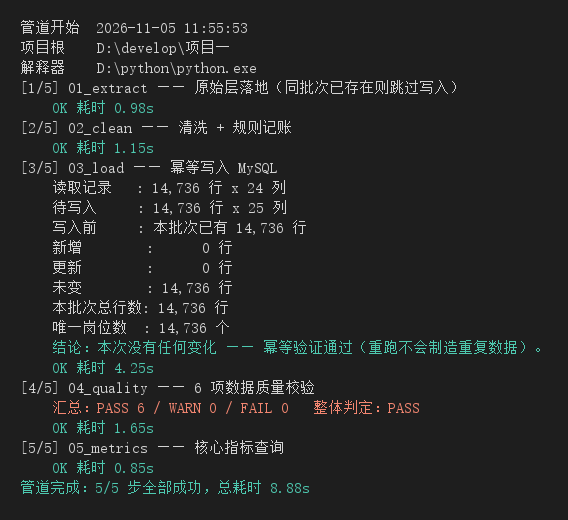
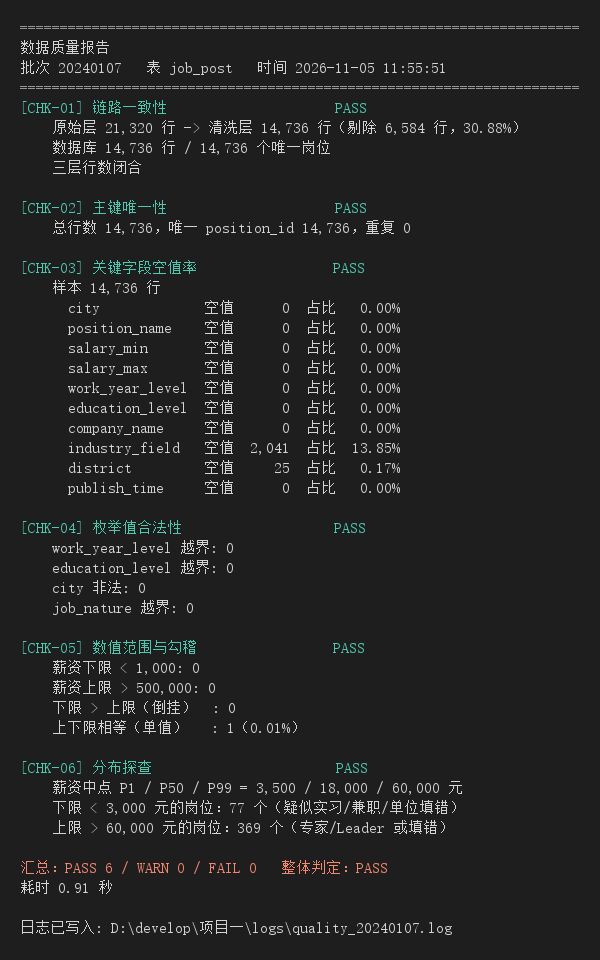
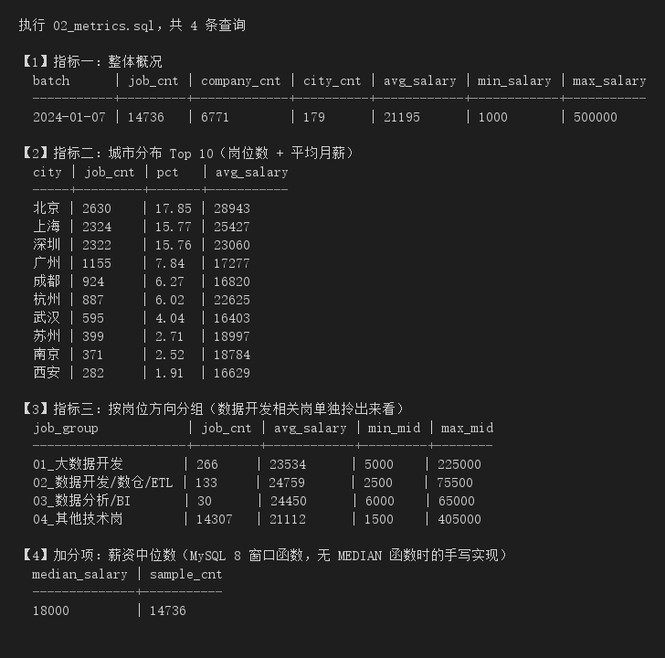

# 招聘岗位数据管道（离线 ETL）

把一份 2.1 万行的招聘岗位 CSV，做成**可重复运行、可监控、可查询**的离线数据管道：
抽取 → 清洗 → 幂等入库 → 数据质量校验 → 指标输出。

> 这是一个「数据开发向」的项目，不是数据分析报告。
> 重点不在画了多少图，而在于：规则可配置、任务可重跑、出错能发现、指标有口径。

---

## 1. 数据流

```
data/raw/lagou_2024.csv         原始 CSV（21,320 行 × 21 列）
        │
        ▼  01_extract.py          只落快照，不改一个字节
data/raw/raw_20240107.csv       原始层（对齐 ODS）
        │
        ▼  02_clean.py            去重 / 脏值归一 / 薪资拆分 / 经验学历编码
data/clean/clean_20240107.csv   清洗层（对齐 DWD，14,736 行 × 24 列）
        │
        ▼  03_load.py             幂等写入（唯一键 + ON DUPLICATE KEY UPDATE）
MySQL  recruit.job_post         14,736 行
        │
        ├─▶ 04_quality_check.py   6 项校验 → logs/quality_*.log
        └─▶ 05_metrics.py         4 个指标 → 控制台表格 + logs/metrics_*.log
```

## 2. 数据源

| 项目 | 内容 |
|---|---|
| 来源 | 拉勾招聘公开岗位数据（社区整理的快照） |
| 规模 | 21,320 行 × 21 列，24.9 MB |
| 覆盖 | 179 个城市，6,771 家公司 |
| 时间 | 岗位发布时间 2022-08 ~ 2024-01，抓取时点 2024-01-07 |
| 位置 | `data/raw/lagou_2024.csv`（**不进 Git**） |

## 3. 快速开始

```bash
# 1. 依赖
pip install pandas pymysql cryptography python-dotenv

# 2. 配置数据库连接：复制模板再填自己的密码
#    Windows:   copy .env.example .env
#    Linux/mac: cp .env.example .env
#    .env 已被 .gitignore 忽略，不会进 Git

# 3. 一条命令跑完整条管道
python run_pipeline.py
# Windows 也可以双击  run_pipeline.bat
```

也可以单步执行，方便调试：

```bash
python src/01_extract.py
python src/02_clean.py
python src/03_load.py
python src/04_quality_check.py
python src/05_metrics.py
```

**全链路实测耗时 9.3 秒**（14,736 行，本机 MySQL 8.0.26）。

### 3.1 定时调度

生产上这条管道应该挂在调度器上每天跑。两种写法：

```bat
:: Windows 任务计划：每天 02:00 跑一次
schtasks /Create /TN "recruit_pipeline" /SC DAILY /ST 02:00 ^
  /TR "D:\develop\项目一\run_pipeline.bat" /F
```

```bash
# Linux crontab：每天 02:00 跑一次
0 2 * * * cd /path/to/project && /usr/bin/python3 run_pipeline.py >> logs/cron.log 2>&1
```

> 注意：本项目的数据是**单时点快照**，每天跑一次不会产生新行——`03_load` 会输出「新增 0 / 未变 14,736」。
> 这不是跑失败了，恰恰是幂等在起作用。接入真实增量数据源后，只需替换 `01_extract.py` 的取数逻辑，后四步一行都不用改。

## 4. 目录结构

```
项目一/
├── config/
│   ├── settings.py         # 路径与数据库连接（读 .env）
│   ├── rules.py            # 所有清洗规则（改规则不改代码）
│   └── __init__.py
├── data/
│   ├── raw/                # 原始层，只读不改
│   └── clean/              # 清洗层
├── docs/
│   ├── 字段说明.md          # 字段含义、清洗规则、口径
│   └── images/             # 运行效果图（README 引用）
├── logs/                   # 每次运行的分步日志（不入库不入 Git）
├── sql/
│   ├── 01_create_tables.sql
│   └── 02_metrics.sql
├── src/
│   ├── 01_extract.py
│   ├── 02_clean.py
│   ├── 03_load.py
│   ├── 04_quality_check.py
│   └── 05_metrics.py
├── run_pipeline.py         # 总调度入口
├── run_pipeline.bat        # Windows 一键运行
├── .env                    # 本地文件（数据库密码），不进 Git
└── .gitignore
```

## 5. 五个关键设计

### 5.1 分层：raw 层永不修改
`01_extract.py` 只做一件事——把源文件原样存成带批次号的快照，一个字节都不改。
以后发现清洗规则写错了，可以从 raw 重跑，不用重新找数据。这是所有数据管道的地基。

### 5.2 规则配置化：`config/rules.py`
去重键、脏值映射表、薪资正则、合法区间、经验/学历编码表，全部是常量。
换一份数据、改一条规则，改配置就行，不动脚本。

### 5.3 幂等：重跑不产生重复数据
```sql
UNIQUE KEY uk_position_batch (position_id, batch_date)
```
```sql
INSERT INTO job_post (...) VALUES (...)
ON DUPLICATE KEY UPDATE col = VALUES(col)   -- etl_time 故意不更新
```
实测：连跑两次 `03_load.py`，第二次输出 **新增 0 / 更新 0 / 未变 14,736**，`SELECT COUNT(*)` 不变。

### 5.4 批次：`batch_date` 贯穿全链路
同一岗位在不同月份被抓到，是两条记录（不同批次），而不是互相覆盖。
这样管道天然支持增量，项目二搬到 Hive 时可以直接当分区键用。

### 5.5 质量校验：6 项，失败不静默
| 编号 | 校验项 | 通过标准 |
|---|---|---|
| CHK-01 | 链路一致性 | raw → clean → DB 三层行数闭合 |
| CHK-02 | 主键唯一 | position_id 重复数 = 0 |
| CHK-03 | 空值率 | 核心字段 ≤5%，非核心 ≤20% |
| CHK-04 | 枚举合法性 | 经验/学历/城市/工作性质无越界值 |
| CHK-05 | 数值范围 | 薪资 1,000 ~ 500,000，上下限不倒挂 |
| CHK-06 | 分布探查 | P1/P50/P99 + 极端值计数（只报警不阻断）|

CHK-01 是整条管道最有价值的一项：任何一步「只跑了一半」「跑的是旧批次」，这里立刻 FAIL。

## 6. 实测结果

### 6.1 一条命令跑完五步



> 图片由脚本真实运行输出渲染（完整日志见 `logs/pipeline_*.log`）。
> 这次是重跑：`01_extract` 跳过写入、`03_load` 新增 0 / 未变 14,736 —— **幂等生效**。

### 6.2 数据质量报告（6 项全 PASS）



### 6.3 指标查询结果



### 6.4 整体

| 指标 | 值 |
|---|---|
| 岗位数 | 14,736 |
| 公司数 | 6,771 |
| 城市数 | 179 |
| 平均月薪 | 21,195 元 |
| 中位数月薪 | 18,000 元 |

### 6.5 城市分布 Top 5

| 城市 | 岗位数 | 占比 | 平均月薪 |
|---|---:|---:|---:|
| 北京 | 2,630 | 17.85% | 28,943 |
| 上海 | 2,324 | 15.77% | 25,427 |
| 深圳 | 2,322 | 15.76% | 23,060 |
| 广州 | 1,155 | 7.84% | 17,277 |
| 成都 | 924 | 6.27% | 16,820 |

### 6.6 岗位方向

| 方向 | 岗位数 | 平均月薪 |
|---|---:|---:|
| 大数据开发 | 266 | 23,534 |
| 数据开发 / 数仓 / ETL | 133 | 24,759 |
| 数据分析 / BI | 30 | 24,450 |
| 其他技术岗 | 14,307 | 21,112 |

> 均值 21,195 > 中位数 18,000，差 3,195 元 —— 薪资右偏，所以两个数都得报。

## 7. 清洗规则一览（`02_clean.py` 的记账日志）

```
[000] 读取原始层            21,320 行 × 21 列
[001] 丢弃长文本列          21 → 20 列（positionDetail，96.7% 含 <br />）
[002] 按 positionId 去重    21,320 → 14,736，剔除 6,584 行（30.88%）
[003] 脏值归一              2 行（"不需要融資" → "不需要融资"）
[004] 薪资拆分              成功 14,736，失败 0，倒挂 0
[005] 经验/学历编码          未映射 0
[999] 输出                  14,736 行 × 24 列，5.06 MB
```

去重率 30.88% 不是数据坏了，而是**同一岗位被反复抓取**——这正是真实数据的样子。

## 8. 踩坑记录（都是实际踩到再修掉的）

1. **文件 238,919 行 ≠ 记录 21,320 条**
   `positionDetail` 里有换行，被 CSV 引号包着。数文件行数得到的是「物理行」，统计一律用 `len(df)`。

2. **`(1046, 'No database selected')`**
   建库那条连接没指定 database 就执行 `CREATE TABLE`。修法：`CREATE DATABASE` 后先 `USE`。

3. **`(1525, "Incorrect DATETIME value: ''")`**
   `SUM(publish_time IS NULL OR publish_time='')` —— DATETIME 列不能和空字符串比较。要按类型分开判断。

4. **`ValueError: unsupported format character '?' (0xb7)`**
   SQL 里的 `LIKE '%·%'` 被 pymysql 当作格式化占位符。字面量 `%` 要写成 `%%`。

5. **同一 positionId 的 `createTime` 完全相同**
   只按 createTime 排序去重，实际等于「随便留一条」。加了二级排序键 `create_at` 才有意义。
   实测 3,568 个重复组里有 2,841 组（79.6%）必须靠二级键决胜负。

6. **规则拦不住合法范围内的异常值**
   `NLP实习生 300k-400k`、`全栈工程师 1k-2k` 都在 1,000~500,000 的合法区间内。
   这就是为什么需要 CHK-06 分布探查——**清洗 ≠ 质量校验**。

7. **中文在管道里变乱码**
   子进程默认用系统编码输出。给子进程注入 `PYTHONIOENCODING=utf-8` 才稳。

## 9. 后续演进

- **分层升级**：清洗层数据可直接导入 Hive，按 ODS / DWD / DWS / ADS 四层重建，做维度建模与分区设计。
- **已预留的扩展点**：
  - `batch_date` 即分区键雏形，迁到 Hive 后可直接作为 `dt` 分区；
  - `data/clean/` 的结构已对齐 DWD，无需改造即可作为输入；
  - 幂等写入在当前实现下是「唯一键 + `ON DUPLICATE KEY UPDATE`」，迁到 Hive 后对应「按分区 `INSERT OVERWRITE`」的重写语义。
- **增量批次**：接入新快照即产生新的 `batch_date`，历史批次不受影响。
